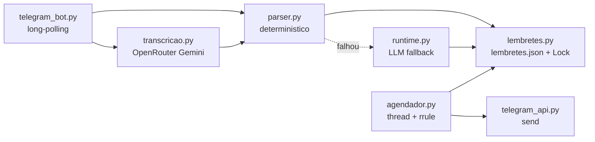

# AGENTS.md

Telegram assistant bots. The first agent is **agenda**: creates, lists and
cancels reminders from **text or voice**, with recurrence and a scheduler that
notifies at the right time. Same architecture as `persona-bots`: environment
config, native long-polling, `data/<agent>/` state, one container per agent.
There is **no test suite, linter or build step** — verification is running the
pieces directly.

## Architecture



- `parser.interpretar()` is deterministic and never persists; it returns a
  `Resultado` with the resolved absolute datetime. `runtime.interpretar()` is
  only called on failure and its fields go through `parser.de_campos()`.
- `lembretes.py` owns the JSON store (atomic tmp + `os.replace`, `RLock`).
- `agendador.py` is a daemon thread woken by `threading.Event`; sleep is
  clamped to 30 s. On due it sends, then computes `rrule.after()`.
- Catch-up: `TOLERANCIA_MIN`; late one-shots notify once, overdue recurring
  occurrences are skipped to the next future one.
- Dates/times are **naive local** (`TIMEZONE`), so wall-clock reminders stay
  fixed across DST.

## Configuration (environment)

| Var | Meaning | Default |
|---|---|---|
| `AGENT` | loads `.opencode/agents/<AGENT>.md`; logger name | `agenda` |
| `BOT_NAME` | display name used in greetings (overrides `bot_name:`) | `AGENT` capitalized |
| `TIMEZONE` | zone for all schedules | `America/Sao_Paulo` |
| `STATE_DIR` | lembretes.json / bot.log / bot.pid | `data/<AGENT>` |
| `HORA_PADRAO` | time for "todos os dias" shortcut | `08:00` |
| `TOLERANCIA_MIN` | max lateness still notified | `120` |
| `AUDIO_ENABLED` | accept voice/audio messages | `true` |
| `TRANSCRIBE_MODEL` | OpenRouter multimodal model | `google/gemini-2.5-flash` |
| `TRANSCRIBE_MAX_SEG` / `AUDIO_MAX_MB` | audio limits | `120` / `10` |
| `LLM_FALLBACK` | LLM when deterministic parsing fails | `true` |
| `TELEGRAM_BOT_TOKEN`, `TELEGRAM_ALLOWED_USER_IDS` | secret (env_file) | — |
| `OPENROUTER_API_KEY` | secret (`.secrets/openrouter.env`) | — |

With no `OPENROUTER_API_KEY`, set `AUDIO_ENABLED=false` and `LLM_FALLBACK=false`;
text + deterministic parser still work.

## Layout

```
.opencode/agents/<agent>.md      persona/tone; `model:` optional (V2 frontmatter)
.secrets/openrouter.env          shared OpenRouter key (audio + fallback)
.secrets/<agent>/telegram.env    one bot/token per agent
data/<agent>/                    lembretes.json, bot.log, bot.pid
docker-compose.prod.yml          VPS deploy: GHCR image, no build
.github/workflows/               ci, publish (GHCR), deploy (SSH), retention
```

`config.py` loads `.secrets/openrouter.env` and `.secrets/<AGENT>/telegram.env`
(plus `.secrets/telegram.env` fallback) at import, so a plain
`./.venv/bin/python telegram_bot.py` works if the files exist.

## Core scripts

All Python in repo root; host runs use `./.venv/bin/python <script>`.

- `config.py` — env parsing and secret loading; computes `TZ` (`ZoneInfo`).
- `telegram_api.py` — Bot API client: `api`, `send`, `typing`, `download_file`,
  `redact` (token never leaks into logs).
- `telegram_bot.py` — long-poll; commands `/start` `/help` `/id` `/listar`
  `/cancelar`; text and `voice`/`audio` messages processed in worker threads
  (one message at a time per chat).
- `parser.py` — deterministic NL → `Resultado` (`criar`/`cancelar`/`erro`),
  `de_campos()` validation for the LLM fallback, `formatar()`/`descrever()`.
- `lembretes.py` — JSON store CRUD; `buscar_por_texto()` = exact → substring →
  `difflib` fuzzy; soft-delete keeps history.
- `agendador.py` — scheduler thread (`Agendador`); `acordar()` on create/cancel.
- `transcricao.py` — OpenRouter chat completions with `input_audio` base64
  (`ogg`); prompt fixed to literal pt-BR transcription.
- `runtime.py` — LLM fallback (JSON object, revalidated), agent frontmatter
  reader, `bot_name()`/`model_for()`.
- `logsetup.py` — stdlib logging to stdout; logger `<AGENT>.*`.

## Data model (`data/<agent>/lembretes.json`)

```json
[{"id":"a1b2c3","chat_id":123,"texto":"tomar remedio","rrule":"FREQ=DAILY",
  "primeira":"2026-11-18T08:00:00","proxima":"2026-11-18T08:00:00",
  "ativo":true,"origem":"audio","transcricao":"me lembre todos os dias ...",
  "criado":"2026-11-17T20:12:00","ultimo_envio":null,
  "perdido_notificado":false,"cancelado_em":null,"concluido_em":null}]
```

`ativo=false` (cancel/conclude) is never notified; the scheduler re-reads the
record right before sending.

## Docker (one container per agent)

- `Dockerfile` — `python:3.12-slim` + venv; deps `requests`, `python-dateutil`,
  `tzdata`. No ffmpeg/whisper: audio goes to OpenRouter.
- `docker-entrypoint.sh` — `exec`s `telegram_bot.py` as PID 1.
- `docker-compose.yml` — `x-agente` anchor; non-secret config in `environment`,
  secrets via `env_file`, state via `./data/<agent>:/app/.state`.
- `docker-compose.prod.yml` — VPS variant: `image: ghcr.io/...` (no `build`),
  `TAG` from `.env`; same env/volume. See README "Deploy" for CI/CD.

## Verification (no test suite)

```bash
./.venv/bin/python -c "import parser; from datetime import datetime; \
 print(parser.interpretar('me lembre em 18/11 as 8h de tomar remedio, repetir todos os dias', datetime(2026,11,17,22,0)))"
./.venv/bin/python transcricao.py teste.ogg
./.venv/bin/python telegram_bot.py
docker compose up -d --build && docker compose logs -f agenda
```

## Notes

- `.gitignore` excludes `data/`, `.venv/`, `.secrets/*` (only `*.example` kept),
  `__pycache__/`, `.env`.
- **Never** run two instances with the same token — Telegram returns `409
  Conflict`.
- Restarts reload `lembretes.json`; recurring reminders are recomputed from
  their stored `proxima`, so no notification is lost (within tolerance).