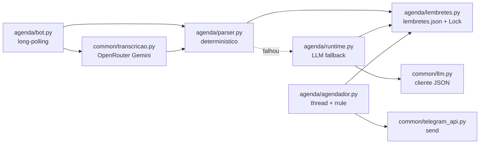
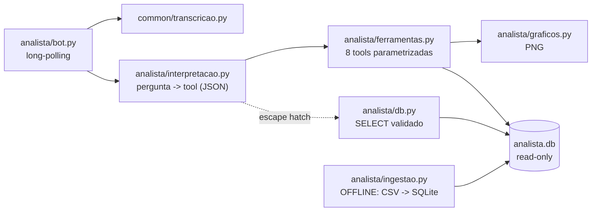

# AGENTS.md

Telegram assistant bots. Two agents share one image and one repo:

- **agenda** — creates, lists and cancels reminders from **text or voice**,
  with recurrence and a scheduler that notifies at the right time.
- **analista** — business analyst over a **SQLite artifact** of sales, answering
  questions (revenue, cost, margin, rankings, evolution) with text and charts.

Same architecture as `persona-bots`: environment config, native long-polling,
`data/<agent>/` state, one container per agent. There is **no test suite or
linter** — verification is running the pieces directly, and `ci.yml` runs smoke
scripts (parser, import graph, ingestion + tools + charts on a fixture base).

## Repository layout

One package per agent, shared capabilities at the root:

```
common/     config, logger, Telegram client, audio, LLM client — no business rules
agenda/     everything that knows what a "lembrete" is
analista/   business analysis over a SQLite artifact (ingestion is offline)
```

Each agent package has a `config.py` that calls `common.config.iniciar(<agente>)`
on import and a `bot.py` with `main()`. The entrypoint is always
`python -m <agente>`; modules import across packages by absolute path
(`from common import telegram_api`), never the other agent's package.

## Architecture



- `parser.interpretar()` is deterministic and never persists; it returns a
  `Resultado` with the resolved absolute datetime. `runtime.interpretar()` is
  only called on failure and its fields go through `parser.de_campos()`.
- `lembretes.py` owns the JSON store (atomic tmp + `os.replace`, `RLock`).
- `agendador.py` is a daemon thread woken by `threading.Event`; sleep is
  clamped to 30 s. On due it sends, then computes `rrule.after()`.
- Catch-up: `TOLERANCIA_MIN`; late one-shots notify once, overdue recurring
  occurrences are skipped to the next future one.
- Dates/times are **naive local** (`TIMEZONE`), so wall-clock reminders stay
  fixed across DST.

## Agente: analista



- **Ingestion is offline**: `python -m analista.ingestao --csv <dir|arquivo>`
  runs on the host, outside the container and outside the boot. The bot never
  imports `ingestao` and never writes to the base; the artifact is mounted.
- The artifact is atomic (`<saida>.tmp` + `os.replace`) and self-describing
  (`meta` with `schema_version`, sources, hashes and totals). Swapping the base
  needs no restart: the next query opens a new connection.
- `interpretacao.responder()` sends the catalog + view schema to the LLM and
  receives `{"acao": "ferramenta"|"sql"|"texto", ...}`. The model **never
  computes**: it only picks the tool/args; SQLite does the arithmetic.
- A failing tool/SQL goes back to the model once with the error; the second
  failure becomes a request for clarification instead of a retry loop.
- `consultar_sql` is the escape hatch: read-only connection, `SELECT`/`WITH`
  only, single statement, table whitelist (`vendas`, `v_vendas`, `v_mensal`,
  `meta`), row cap and a 10 s progress-handler timeout. The SQL is logged and
  visible via `/sql`.
- Charts are rendered only when asked ("grafico"/"evolucao"/"pizza" in the
  question, `/grafico`, `/pizza` or the inline button). Types: `linha`, `barra`,
  `comparacao`, `pizza` and `rosca`; bars get one colour each. The response
  carries one button per **eligible** type, in the order `Barra`, `Linha`,
  `Pizza` (`graficos.tipos_elegiveis`): a time series offers Barra+Linha, a
  ranking offers Barra (+Pizza when the metric is additive), a comparison only
  Barra, and a summary offers none. There is no `Tabela` button — the table is
  already in the message. Pie aggregates the tail into "Outros" against the
  **period total** and is refused for non-additive metrics or negative values;
  the caption warns when the shown slices cover little of the total (e.g.
  cliente). `matplotlib` is imported on demand, so the bot starts fast and still
  works with `GRAFICO_ENABLED=false`.
- `periodo.py` resolves "2024", "marco de 2024", "1o trimestre de 2023",
  "ultimos 30 dias", "de 01/03 a 15/04" and "tudo". Without an explicit year it
  uses the **last year of the base**, not the current year.

## Configuration (environment)

| Var | Meaning | Default |
|---|---|---|
| `BOT_AGENT` | package to run (`python -m <BOT_AGENT>`); loads `.opencode/agents/<BOT_AGENT>.md`; logger name | package name |
| `BOT_NAME` | display name used in greetings (overrides `bot_name:`) | `BOT_AGENT` capitalized |
| `TIMEZONE` | zone for all schedules | `America/Sao_Paulo` |
| `STATE_DIR` | agent state: `lembretes.json`/log/pid (agenda), `analista.db`/`graficos/`/`export/` (analista) | `data/<BOT_AGENT>` |
| `HORA_PADRAO` | agenda: time for "todos os dias" shortcut | `08:00` |
| `TOLERANCIA_MIN` | agenda: max lateness still notified | `120` |
| `AUDIO_ENABLED` | accept voice/audio messages | `true` |
| `TRANSCRIBE_MODEL` | OpenRouter multimodal model | `google/gemini-2.5-flash` |
| `TRANSCRIBE_MAX_SEG` / `AUDIO_MAX_MB` | audio limits | `120` / `10` |
| `LLM_FALLBACK` | agenda: LLM when deterministic parsing fails | `true` |
| `ANALISTA_DB` | SQLite artifact read by the analista (read-only) | `$STATE_DIR/analista.db` |
| `GRAFICO_ENABLED` | render PNG charts on demand | `true` |
| `GRAFICO_MAX_FATIAS` | slices before aggregating the rest into "Outros" | `10` |
| `ANALISTA_MAX_LINHAS` / `ANALISTA_TIMEOUT_SQL` | row cap and SQL timeout (s) | `5000` / `10` |
| `HISTORICO_TURNOS` | follow-up context kept per chat | `8` |
| `ANALISTA_CSV` | default `--csv` for the offline ingestion | — |
| `TELEGRAM_BOT_TOKEN`, `TELEGRAM_ALLOWED_USER_IDS` | secret (env_file); allowed list is required — without it the bot refuses every chat | — |
| `OPENROUTER_API_KEY` | secret (`.secrets/openrouter.env`) | — |

`BOT_AGENT` is deliberately **not** called `AGENT`: the ambient environment of
CI and agent runners often sets `AGENT=1`, which silently selected the wrong
secret directory.

With no `OPENROUTER_API_KEY`, set `AUDIO_ENABLED=false` and `LLM_FALLBACK=false`;
text + deterministic parser still work.

## Layout

```
common/                          shared: config, log, Telegram, audio, LLM
agenda/                          agenda agent (bot, parser, lembretes, agendador)
analista/                        analyst agent + offline ingestion
.opencode/agents/<agent>.md      persona/tone; `model:` optional (V2 frontmatter)
.secrets/openrouter.env          shared OpenRouter key (audio + fallback)
.secrets/<agent>/telegram.env    one bot/token per agent
data/<agent>/                    state: lembretes.json, bot.log, bot.pid
data/analista/                   analista.db (offline) + graficos/ + export/ (gitignored)
docker-compose.prod.yml          VPS deploy: GHCR image, no build
.github/workflows/               ci, publish (GHCR), deploy (SSH), retention
```

`common/config.py` loads `.secrets/openrouter.env` at import and
`.secrets/<BOT_AGENT>/telegram.env` (plus `.secrets/telegram.env` fallback)
inside `iniciar()`, so `./.venv/bin/python -m agenda` works if the files exist.

## Core scripts

Agent packages run as `python -m <agente>` (host: `./.venv/bin/python -m <agente>`).

`common/`:
- `config.py` — `BASE`, `iniciar(agente)`, env helpers (`flag`/`inteiro`/`texto`/
  `caminho`), secret loading, `agora()`, `TZ` (`ZoneInfo`).
- `telegram_api.py` — Bot API client: `api`, `send`, `send_photo`,
  `send_document`, `typing`, `download_file`, `editar`/`responder_callback`
  (inline buttons), `escape`, `redact`; token read lazily so import order never
  matters.
- `transcricao.py` — OpenRouter chat completions with `input_audio` base64
  (`ogg`); prompt fixed to literal pt-BR transcription.
- `llm.py` — OpenRouter JSON client (`chamar_json`), agent frontmatter reader,
  `bot_name()`/`model_for()`.
- `logsetup.py` — stdlib logging to stdout; logger `<BOT_AGENT>.*`.

`agenda/`:
- `config.py` — `HORA_PADRAO`, `TOLERANCIA_MIN`, `LEMBRETES_FILE`; re-exports
  the common knobs (`TZ`, `AUDIO_ENABLED`, ...) so the package keeps `config.X`.
- `bot.py` — long-poll (`message` + `callback_query`); commands
  `/start` `/help` `/id` `/listar` `/cancelar` `/apagar_inativos` (preview with
  Apagar/Cancelar buttons); text and `voice`/`audio` messages processed in
  worker threads (one message at a time per chat).
- `parser.py` — deterministic NL → `Resultado` (`criar`/`cancelar`/`erro`),
  `de_campos()` validation for the LLM fallback, `formatar()`/`descrever()`.
- `lembretes.py` — JSON store CRUD; `buscar_por_texto()` = exact → substring →
  `difflib` fuzzy; soft-delete keeps history; `apagar_inativos()` purges
  `ativo: false` for good (scoped to one chat when `chat_id` is given).
- `agendador.py` — scheduler thread (`Agendador`); `acordar()` on create/cancel.
- `runtime.py` — LLM fallback contract for reminders (JSON object, revalidated).

`analista/`:
- `ingestao.py` — **offline** CSV → SQLite (`python -m analista.ingestao`); 12
  canonical columns with aliases, atomic swap, `VACUUM`, `meta` table.
- `db.py` — read-only connection (`mode=ro`, `query_only`), `schema_version`
  check, guardrails for `validar_sql()`/`executar_sql()`.
- `periodo.py` — pt-BR dates/intervals → `Periodo(de, ate)`; deterministic.
- `ferramentas.py` — `info_base`, `resumo`, `serie`, `ranking`,
  `distribuicao`, `comparar`, `tabela`, `consultar_sql` + `CATALOGO`/`executar`.
- `interpretacao.py` — question → `{acao, ferramenta, args}`; executes the tool
  and returns a `Resultado` (or plain text); feeds tool errors back once.
- `formato.py` — pt-BR numbers and monospace tables for `<pre>`.
- `resultado.py` — the `Resultado` dataclass shared by tools/formatters.
- `graficos.py` — PNG (`linha`, `barra`, `comparacao`, `pizza`/`rosca`) with
  lazy matplotlib, one colour per bar, `tipos_elegiveis()`, `pode_pizza()`,
  `cobertura` and "Outros" aggregation.
- `conversa.py` — in-memory per-chat history for follow-ups.
- `consultas.py` — CLI to run any tool without Telegram or LLM.

## Data model (`data/<agent>/lembretes.json`)

```json
[{"id":"a1b2c3","chat_id":123,"texto":"tomar remedio","rrule":"FREQ=DAILY",
  "primeira":"2026-11-18T08:00:00","proxima":"2026-11-18T08:00:00",
  "ativo":true,"origem":"audio","transcricao":"me lembre todos os dias ...",
  "criado":"2026-11-17T20:12:00","ultimo_envio":null,
  "perdido_notificado":false,"cancelado_em":null,"concluido_em":null}]
```

`ativo=false` (cancel/conclude) is never notified; the scheduler re-reads the
record right before sending.

## Data model — analista (`data/analista/analista.db`)

Canonical columns (CSV aliases in parentheses): `data` (`data_venda`),
`id_origem` (`Id`, part of the PK with `equipe`), `equipe`, `vendedor`,
`categoria` (`categoria_servico`), `servico` (`produto`/`descricao`),
`quantidade`, `preco_unitario` (`valor`), `custo_unitario` (`custo`), `cliente`,
`estado` (`uf`), `regiao`.

- `vendas` — the raw rows, PK `(equipe, id_origem)`, so ingesting both the team
  files and `relatorio_final.csv` is idempotent (`INSERT OR IGNORE`).
- `v_vendas` — adds `receita`, `custo_total`, `margem`, `ano`, `mes`, `dia`,
  `dia_semana`, `trimestre`. This is the only surface exposed to the LLM.
- `v_mensal` — monthly rollup.
- `meta` — `schema_version`, `gerado_em`, sources + sha256, row count, period
  and totals. The bot refuses an artifact with a different `schema_version`.

Numbers in this base: `receita = quantidade * preco_unitario`,
`custo = quantidade * custo_unitario`, `margem` is **gross** (revenue − cost).
There are no purchases, stock or returns; `cliente` holds repeated surnames and
`Vinicius` appears in two teams — the persona warns about both instead of
silently aggregating them.

## Docker (one container per agent)

- `Dockerfile` — `python:3.12-slim` + venv; deps `requests`, `python-dateutil`,
  `tzdata`, `matplotlib`. No ffmpeg/whisper: audio goes to OpenRouter.
- The image puts `/app/.venv/bin` in `PATH` and `MPLCONFIGDIR=/app/.state/.mpl`,
  so `docker compose exec <agent> python ...` uses the venv and the chart cache
  lands in the volume. The entrypoint still uses the absolute path.
- `docker-entrypoint.sh` — `exec`s `python -m $BOT_AGENT` as PID 1, so the same
  image serves every agent; `BOT_AGENT` comes from the compose `environment`.
- `docker-compose.yml` — `x-agente` anchor; non-secret config in `environment`,
  secrets via `env_file`, state via `./data/<agent>:/app/.state`.
- The `analista` service mounts `./data/analista:/app/.state`; `analista.db` is
  produced on the host and copied with `scp`. It is **never** baked into the
  image (the GHCR package is public and the base is client data).
- `docker-compose.prod.yml` — VPS variant: `image: ghcr.io/...` (no `build`),
  `TAG` from `.env`; same env/volume. See README "Deploy" for CI/CD.

## Verification (no test suite; smoke in CI)

```bash
./.venv/bin/python -m compileall -q common agenda analista
./.venv/bin/python -c "import agenda.parser; from datetime import datetime; \
 print(agenda.parser.interpretar('me lembre em 18/11 as 8h de tomar remedio, repetir todos os dias', datetime(2026,11,17,22,0)))"
./.venv/bin/python -m common.transcricao teste.ogg
./.venv/bin/python -m agenda          # sobe o polling de verdade (nao rode com o bot vivo)
docker compose up -d --build && docker compose logs -f agenda
```

Nunca valide imports rodando `python -m agenda` com o token real: ele inicia o
long-polling e a instancia viva leva `409 Conflict`. Use
`python -c "import agenda.bot"` para verificar o grafo de imports.

```bash
# analista: ingestao offline (host, fora do container) e conferencia dos totais
./.venv/bin/python -m analista.ingestao --csv ~/Downloads/relatorio-vendas-consolidado
./.venv/bin/python -m analista.ingestao --inspecionar data/analista/analista.db

# tools sem Telegram nem LLM
./.venv/bin/python -m analista.consultas info_base
./.venv/bin/python -m analista.consultas resumo periodo=2024
./.venv/bin/python -m analista.consultas ranking dimensao=vendedor periodo=2024 top_n=5
./.venv/bin/python -m analista.consultas serie metrica=receita granularidade=mensal --grafico /tmp/g.png
./.venv/bin/python -m analista.consultas distribuicao dimensao=servico --tipo pizza --grafico /tmp/p.png
```

O gabarito da base atual: **117.085 linhas**, receita `1.014.928.594,05`, custo
`710.521.008,72`, periodo `2022-05-30 .. 2025-05-29`. Se a ingestao imprimir
outro total, a base ou o parser mudou.

## Notes

- `.gitignore` excludes `data/`, `.venv/`, `.secrets/*` (only `*.example` kept),
  `__pycache__/`, `.env`.
- **Never** run two instances with the same token — Telegram returns `409
  Conflict`.
- Restarts reload `lembretes.json`; recurring reminders are recomputed from
  their stored `proxima`, so no notification is lost (within tolerance).
- Secrets live only in GitHub Secrets; the deploy renders `.secrets/*.env` on
  the runner and overwrites the VPS copy every run, so editing those files on
  the VPS does not persist. Rotate with `gh secret set` + `gh workflow run
  deploy.yml` (see README, "Rotacao de chave").